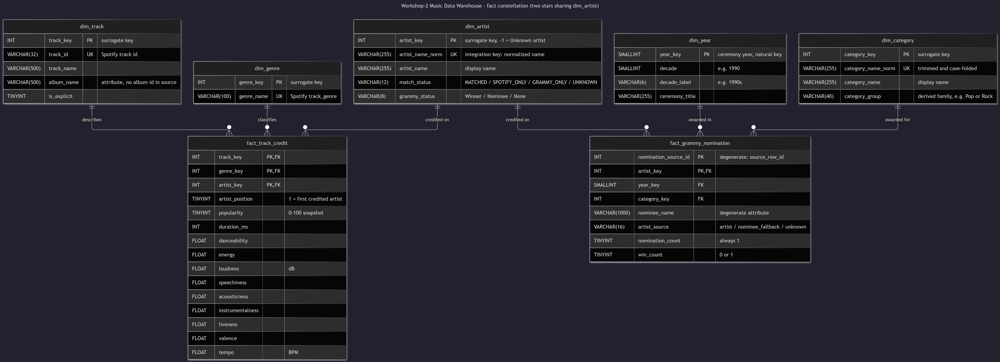
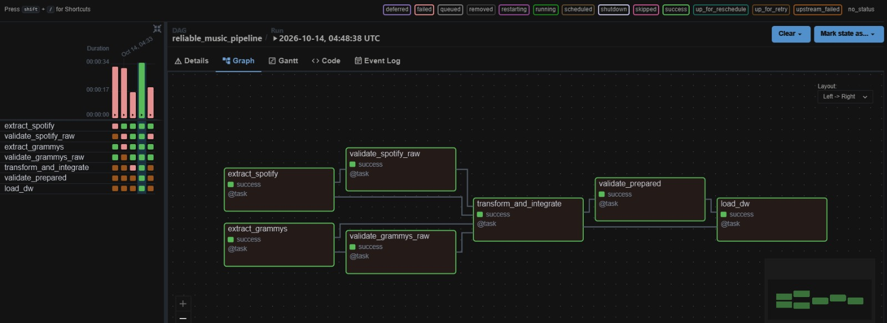
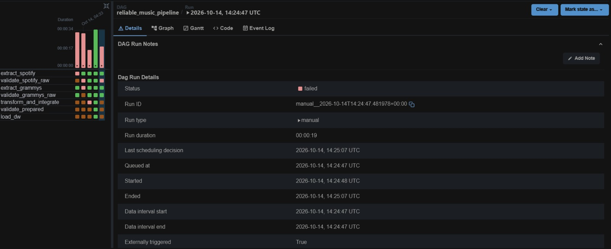
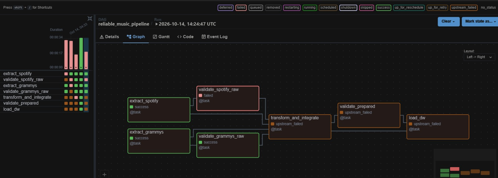
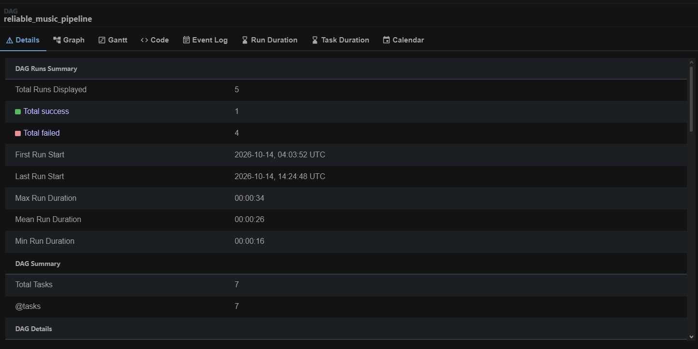
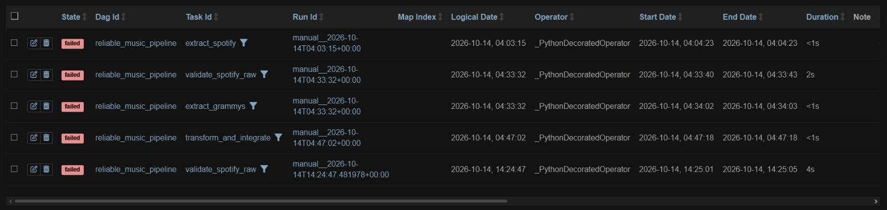
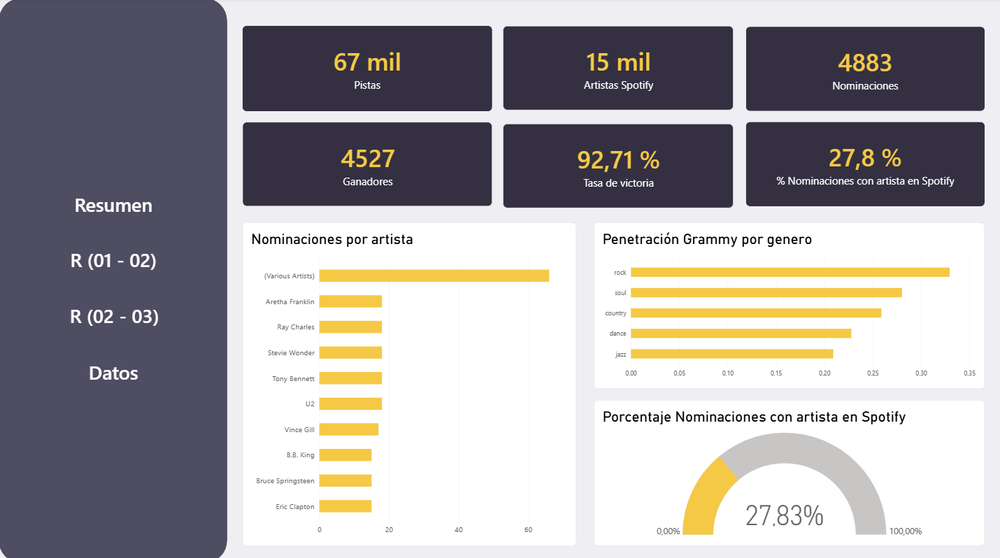
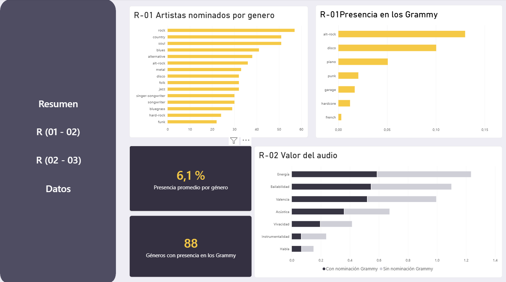
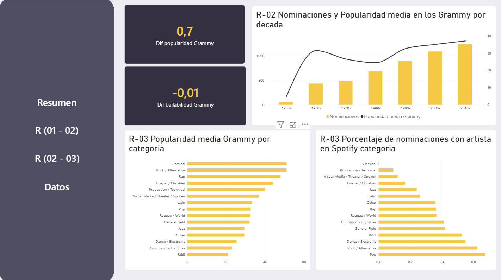
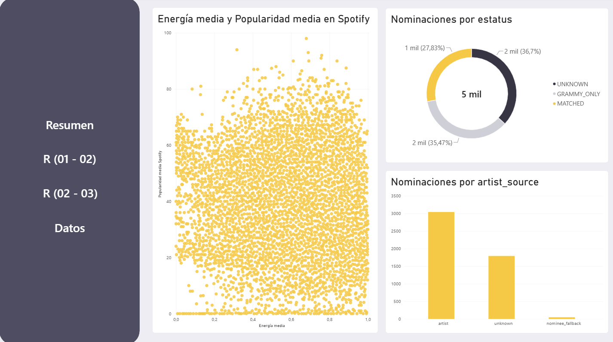

# Workshop-2 · Reliable Batch Data Pipeline

`Juan David Lasso Chaparro`

A reliable batch pipeline that integrates Spotify tracks and Grammy Awards into a trusted dimensional Data Warehouse. The workflow is orchestrated with Apache Airflow, validated with Great Expectations, and explored with Power BI.

---

## Contents

1. [Problem and analytical objective](#1-problem-and-analytical-objective)
2. [Analytical requirements](#2-analytical-requirements)
3. [Data sources](#3-data-sources)
4. [Pipeline architecture](#4-pipeline-architecture)
5. [Data profiling findings](#5-data-profiling-findings)
6. [Quality risks and quality rules](#6-quality-risks-and-quality-rules)
7. [Great Expectations validation design](#7-great-expectations-validation-design)
8. [Transformation and integration strategy](#8-transformation-and-integration-strategy)
9. [Dimensional model](#9-dimensional-model)
10. [Airflow DAG design](#10-airflow-dag-design)
11. [Failure and retry policy](#11-failure-and-retry-policy)
12. [Successful execution evidence](#12-successful-execution-evidence)
13. [Controlled failure evidence](#13-controlled-failure-evidence)
14. [Repeatability strategy](#14-repeatability-strategy)
15. [Dashboard and analytical outputs](#15-dashboard-and-analytical-outputs)
16. [Setup and execution instructions](#16-setup-and-execution-instructions)
17. [Assumptions and limitations](#17-assumptions-and-limitations)

---

## 1. Problem and analytical objective

Spotify describes how popular an artist's music is **today**. The Grammy dataset records which artists were **recognized** (and in which year and category). Neither source can answer how recognition relates to present-day popularity.

The objective is a trusted Data Warehouse that links both sources at artist level and answers the three analytical requirements in section 2.

**Scope**

- In scope: artist-level integration, quality gates on raw and prepared data, a dimensional model, KPIs queried from the Data Warehouse.
- Out of scope: causal claims (the Spotify file has no dates), song-level matching of Grammy nominees to Spotify tracks, Grammy `workers`, `img`, `published_at` and `updated_at`, and any streaming or revenue data.

---

## 2. Analytical requirements

| ID | Analytical requirement | Required data | Source(s) | Expected KPI(s) | Required level of detail |
|---|---|---|---|---|---|
| **AR-01** | **Grammy penetration by genre.** Which Spotify genres are Grammy-dense and which are Grammy-sparse? | Spotify: `artists`, `track_genre`. Grammy: `artist` (with `nominee` as documented fallback) | Spotify CSV + Grammy (MySQL) | **KPI-01** recognized artists ÷ distinct artists per genre. **KPI-02** recognized artists per genre (top 15) | Genre × recognized (yes/no), in **distinct artists** (the Spotify file is sampled per genre, so raw row counts are not comparable) |
| **AR-02** | **Era of recognition.** How do the current popularity and audio profile of recognized artists differ by the Grammy decade in which they were recognized, compared with non-recognized artists? | Grammy: `year` (→ decade), `artist`. Spotify: `artists`, `popularity`, `energy`, `danceability`, `valence`, `acousticness`, `loudness` | Spotify CSV + Grammy (MySQL) | **KPI-03** average artist popularity per decade. **KPI-04** average audio profile per decade vs. the non-recognized baseline | Decade × recognized; artist-level averages (each artist counted once) |
| **AR-03** | **Category family vs. popularity.** Which Grammy category families are associated with the most popular artists on Spotify, and how well is each family covered by the link? | Grammy: `category` (→ `category_group`), `artist`. Spotify: `artists`, `popularity` | Spotify CSV + Grammy (MySQL) | **KPI-05** average artist popularity per category family. **KPI-06** share of nominations linked to a Spotify artist, per family | Category family (about 14) with drill-down to category; artist-level averages |

**Why both sources are required.** Each requirement needs information that only one source has (genre and popularity from Spotify; recognition, year and category from Grammy). The only attribute they share is the **artist**, so the artist is the integration key (section 8).

---

## 3. Data sources

| Source | Provided form | Rows × columns | How the pipeline reads it | Location in the project |
|---|---|---|---|---|
| Spotify tracks | CSV | 114,000 × 21 (20 data columns + an exported index) | Read directly from the CSV by `extract_spotify` | `data/raw/spotify_dataset.csv` |
| Grammy Awards 1958–2019 | CSV | 4,810 × 10 | **Loaded once into MySQL** (`grammy_source.grammy_awards`) by the source-preparation step. The pipeline then extracts Grammy **from MySQL**, never from the CSV | `data/raw/the_grammy_awards.csv` (read only by `src/source_prep.py`) |

Loading the Grammy CSV into MySQL is *source preparation*: it creates the operational source for extraction. It is **not** the final ETL load, which writes the validated tables into the Data Warehouse (`music_dw`).

---

## 4. Pipeline architecture

```text
SPOTIFY CSV                                   GRAMMY DATABASE (MySQL: grammy_source)
    |                                                  |
extract_spotify                                 extract_grammys
    |                                                  |
validate_spotify_raw ------------+     +------------- validate_grammys_raw
                                 |     |
                                 v     v
                          transform_and_integrate
                                    |
                                    v
                             validate_prepared
                                    |
                                    v
                                 load_dw
                                    |
                                    v
                  DATA WAREHOUSE (MySQL: music_dw) -> KPIs / Power BI
```

- The **raw gates** ensure that data can enter transformation.
- The **prepared gate** ensures that the transformed tables are safe to load.
- `load_dw` only runs when `validate_prepared` succeeds.

**Project components**

| Component | Responsibility |
|---|---|
| `src/extract.py` | Reads both sources without cleaning and saves them as parquet with a metadata file per batch |
| `src/validation.py`, `src/quality_rules.py` | Great Expectations gates (raw and prepared) and the quality rules |
| `src/transform.py` | Cleaning, standardization and integration; builds the star-schema tables |
| `src/load.py` | Transactional load into `music_dw` |
| `src/source_prep.py` | Fills the MySQL source table from the Grammy CSV (with row-count reconciliation) |
| `src/config.py` | Paths and credentials read from `.env` |
| `dags/reliable_music_pipeline.py` | Airflow DAG that calls the functions above in the order shown |
| `sql/source_setup.sql`, `sql/dw_schema.sql` | DDL of the source table and of the Data Warehouse |

---

## 5. Data profiling findings

Two notebooks profile the data without modifying it: `notebooks/01_profiling_spotify.ipynb` and `notebooks/02_profiling_grammy.ipynb`. Each notebook exports a risk table. The findings below come from the real files.

### 5.1 Spotify (`spotify_dataset.csv`)

| ID | Attribute | Profiling evidence | Potential quality risk | Related requirement |
|---|---|---|---|---|
| RK-SP-01 | `Unnamed: 0` | Row index exported with the CSV | Technical column that could be mistaken for a key | — |
| RK-SP-02 | `artists`, `album_name`, `track_name` | 1 row with nulls (`artists`, `track_name`) | A track without artist cannot be linked to Grammy | AR-01..03 |
| RK-SP-03 | `track_id`, `track_genre` | 114,000 rows, 89,741 distinct `track_id`; 16,299 tracks listed under more than one genre; 450 repeated (`track_id`, `track_genre`) pairs | One row is a track **listed under a genre**: `track_id` is not a primary key | AR-01..03 |
| RK-SP-04 | popularity and audio features | 720 tracks have different values in their repeated rows (median gap 1 point, max 44) | A track with two values for a track-level measure | AR-02, AR-03 |
| RK-SP-05 | all columns | 450 exact duplicate rows | Duplicated facts | AR-01..03 |
| RK-SP-06 | `artists` | 26.4% of rows have more than one artist separated by `;` (up to 38) | Multi-valued field: whole-text comparison misses collaborations | AR-01..03 |
| RK-SP-07 | `artists` | 81 cleaned artist names are written in more than one way | Duplicate artists; broken match with Grammy | AR-01..03 |
| RK-SP-08 | `track_genre` | 114 genres with 1,000 rows each | The row count reflects the sampling design, not genre size | AR-01 |
| RK-SP-09 | `tempo`, `duration_ms`, `loudness`, `time_signature` | `loudness` > 0: 90 rows; `tempo` ≤ 0: 157; duration outside 1 ms–20 min: 82; `time_signature` outside 3–7: 1,136 | Sentinel values bias averages | AR-02 |
| RK-SP-10 | `popularity` | 14.1% of rows have popularity = 0 | Mixes "not popular" with "no signal" and pulls averages down | AR-02, AR-03 |
| RK-SP-11 | whole file | No date, year or timestamp column | Spotify cannot be placed on the Grammy timeline | AR-02, AR-03 |

### 5.2 Grammy (MySQL source table, 4,810 rows)

| ID | Attribute | Profiling evidence | Potential quality risk | Related requirement |
|---|---|---|---|---|
| RK-GR-01 | `artist` | 1,840 rows (38.3%) have no artist; 246 of 638 categories never have one | Those nominations cannot be linked to Spotify by artist | AR-01..03 |
| RK-GR-02 | `workers`, `img` | 45.5% and 28.4% null; `workers` is free text | Not reliable inputs; out of scope | — |
| RK-GR-03 | (`year`, `category`, `nominee`, `artist`) | No repeated award rows in the source | Would double count if they appeared | AR-01..03 |
| RK-GR-04 | `winner` | Single value: `True` in all 4,810 rows | Only winners exist: winner vs. nominee cannot be analysed | — |
| RK-GR-05 | `category` | 638 distinct values, 629 after trimming and case-folding; 2 rows with extra spaces | Variants split one category | AR-03 |
| RK-GR-06 | `category` → family | Keyword rules leave 12.1% of rows in "Other" in the profile (3.4% after the final rule set) | Family not interpretable if too many rows are "Other" | AR-03 |
| RK-GR-07 | `artist` | 575 of 2,970 non-null values (19.4%) contain a separator (`,`, `&`, `and`, `feat`, `/`) | Collaborations vs. real group names such as "Earth, Wind & Fire" | AR-01..03 |

### 5.3 Cross-source (Grammy ⇄ Spotify)

| ID | Aspect | Profiling evidence | Potential quality risk | Related requirement |
|---|---|---|---|---|
| RK-XS-01 | artist linking | Grammy rows linked, by strategy: exact text 26.5%; cleaned name 29.1%; cleaned + composite split 36.3%; + nominee fallback 37.9% | Exact matching under-links; some rows will never link | AR-01..03 |
| RK-XS-02 | empty artist → nominee | Nominee recovers 79 of 1,840 empty-artist rows (4.3%) | Partial recovery; needs a provenance flag | AR-01..03 |
| RK-XS-03 | join cardinality | A row-by-row join through the artist gives 45,840 rows: 25.1× the linked Grammy rows | Multiplies rows and counts every measure several times | AR-01..03 |
| RK-XS-04 | nominee ⇄ track name | Only 970 Grammy rows (20.2%) match a Spotify track name, even on the title alone | Track-level link is weak; integrate at artist level | AR-01..03 |
| RK-XS-05 | time axis | Spotify has no dates; Grammy covers 1958–2019 | Results describe artists today; association, not causation | AR-02, AR-03 |

No duplicate award rows, `year`/`title` inconsistencies or invalid dates were found in the Grammy data.

---

## 6. Quality risks and quality rules

The pipeline uses **25 quality rules**, grouped by layer. Each rule is implemented as one or more Great Expectations expectations, carries its rule ID and severity in the expectation metadata, and appears in the validation evidence.

### 6.1 Severity policy

| Severity | Meaning | Pipeline response |
|---|---|---|
| **Critical** | The violation makes continued processing or loading unsafe | Stops the affected downstream path; the task fails without retry |
| **Warning** | Visibility is required, but the batch may still be valid | Recorded and exposed in the evidence; processing continues |
| **Info** | Monitoring context or trend signal | Recorded only; does not block |

### 6.2 Rules

| Rule | Layer | Attribute(s) | Dimension | Rule and threshold | Severity | Justification |
|---|---|---|---|---|---|---|
| DQ-01 | Spotify raw | 20 columns | Validity (contract) | All 20 expected columns exist (an extra index column is allowed) | Critical | Source contract |
| DQ-02 | Spotify raw | table | Validity (volume) | 57,000–228,000 rows (0.5×–2× of 114,000) | Critical | Detects truncated or duplicated files |
| DQ-03 | Spotify raw | `track_id`, `track_genre` | Completeness | `track_id` non-null; `track_genre` at least 70% non-null | Critical | Fact-table keys |
| DQ-04 | Spotify raw | `artists` | Completeness | At least 99.9% non-null | Critical | RK-SP-02; link to Grammy |
| DQ-05 | Spotify raw | `track_id` + `track_genre` | Uniqueness | No repeated pair (removed in transformation, reported here) | Warning | RK-SP-03, RK-SP-05 |
| DQ-06 | Spotify raw | `popularity` per `track_id` | Consistency | One popularity value per track | Warning | RK-SP-04 |
| DQ-07 | Spotify raw | `popularity`, 7 audio features | Validity | `popularity` 0–100; `danceability`, `energy`, `speechiness`, `acousticness`, `instrumentalness`, `liveness`, `valence` 0–1 | Critical | Documented Spotify scales |
| DQ-08 | Spotify raw | `loudness` | Validity | At least 99% within −60 to 0 dB | Warning | RK-SP-09 |
| DQ-09 | Spotify raw | `popularity` | Validity | At least 80% with popularity ≥ 1 (at most 20% zeros) | Warning | RK-SP-10 |
| DQ-10 | Spotify raw | `tempo`, `duration_ms`, `time_signature` | Validity | At least 98% plausible values (monitoring only) | Info | RK-SP-09; not used by any requirement |
| DQ-11 | Grammy raw | 10 columns | Validity (contract) | All 10 expected columns exist | Critical | Source contract |
| DQ-12 | Grammy raw | table | Validity (volume) | 2,400–9,600 rows (0.5×–2× of 4,810) | Critical | Detects truncated or duplicated extracts |
| DQ-13 | Grammy raw | `year`, `category` | Completeness | 100% non-null | Critical | Feed the decades (AR-02) and families (AR-03) |
| DQ-14 | Grammy raw | `year` | Validity | Numeric, between 1958 and the current year | Critical | Observed range 1958–2019 |
| DQ-15 | Grammy raw | `artist` | Completeness | At least 55% non-null | Warning | RK-GR-01 (38.3% missing by structure) |
| DQ-16 | Grammy raw | `year`, `category`, `nominee`, `artist` | Uniqueness | No repeated award row | Warning | Avoids double counting |
| DQ-17 | Grammy raw | `winner` | Validity | Only `True` or `False` | Critical | Source of `win_count` (0/1) |
| DQ-18 | Grammy raw | `category` | Consistency | No leading, trailing or double spaces | Warning | RK-GR-05 |
| DQ-19 | Grammy raw | `year`, `title` | Consistency | `year` equals the `(YYYY)` written in `title` | Warning | Cross-check of the year |
| DQ-20 | Prepared | dimension keys, fact keys, foreign keys | Integrity | Keys non-null and unique; fact primary keys not repeated; every foreign key exists in its dimension | Critical | Star-schema contract; safe load |
| DQ-21 | Prepared | fact measures | Validity | `popularity` 0–100 and non-null; 7 audio features 0–1; `win_count` in {0, 1}; `year_key` between 1958 and the current year; mean `win_count` for 2019 onward ≤ 0.5 | Critical | Post-transformation invariants |
| DQ-22 | Prepared | `category_group` | Coverage | At least 95% of Grammy fact rows outside "Other" | Warning | RK-GR-06 |
| DQ-23 | Prepared | `match_status` | Coverage | At least 25% of Grammy fact rows linked to a Spotify artist | Critical | RK-XS-01, RK-XS-02 |
| DQ-24 | Prepared | `artist_name_norm` | Consistency | Lower case, single spaces | Warning | RK-SP-07, RK-XS-01 |
| DQ-25 | Prepared | all 7 tables | Validity (schema) | Each table has the columns of the star schema | Critical | Schema contract of the Data Warehouse |

**Design notes**

- Thresholds are engineering decisions. The 100% rules protect contracts and keys (one violation means corruption). Tolerant thresholds (for example DQ-15 and DQ-23) come from the analytical requirements and the structure of the data, not from the fact that the current batch passes.
- Columns that start with `_` (for example `_year_in_title`) are helper columns created on a copy of the data for the check. Extracted data is never modified.

---

## 7. Great Expectations validation design

### 7.1 Design elements

| Element | Use in this project |
|---|---|
| Expectation | One GX check that implements a rule (for example `ExpectColumnValuesToNotBeNull` for DQ-03) |
| Expectation Suite | One suite per data object: `spotify_raw_suite`, `grammy_raw_suite`, `dim_artist_suite`, … |
| Validation Definition | Connects a data object (batch definition of a DataFrame) with its suite: `<object>_validation` |
| Checkpoint | Runs the validation definition and stores the result: `<object>_checkpoint` |
| Validation result | Per rule: success, unexpected count and percent, and up to 5 examples when it fails |

The GX context lives in the `gx/` folder. The first run creates its structure; the suites, validation definitions and checkpoints are created or updated on each run, so reruns never duplicate them.

### 7.2 Gates and data objects

| Gate (DAG task) | Data object(s) | Rules |
|---|---|---|
| `validate_spotify_raw` | `spotify_raw` | DQ-01 to DQ-10 |
| `validate_grammys_raw` | `grammy_raw` | DQ-11 to DQ-19 |
| `validate_prepared` | `dim_artist` | DQ-20, DQ-24, DQ-25 |
| | `dim_track`, `dim_genre`, `dim_category`, `dim_year` | DQ-20, DQ-25 |
| | `fact_track_credit` | DQ-20, DQ-21, DQ-25 |
| | `fact_grammy_nomination` | DQ-20, DQ-21, DQ-25 |
| | `grammy_prepared_joined` (Grammy fact + category family + match status) | DQ-22, DQ-23 |

### 7.3 Policy and evidence

- If a **critical** expectation fails, the gate raises `DataQualityError`. The task fails, downstream tasks do not run, and the database is not touched.
- Every gate writes a JSON file to `docs/evidence/validation/` with the result of every rule (severity, success, counts, percentages and examples). This is the evidence for successful and failed runs.
- GX also keeps its own validation results in `gx/uncommitted/validations/` (ignored by Git).

---

## 8. Transformation and integration strategy

Transformation is one phase that cleans, standardizes, integrates and derives. Every decision has an ID (TR-xx) and the profiling risk that justifies it. Transformations are not written to make a validation pass: the raw gates see the source problems first.

| ID | Rule and rationale | Fields | Before → after (real data) | Exception handling | Analytical impact |
|---|---|---|---|---|---|
| TR-01 | Drop the exported index column (RK-SP-01) | `Unnamed: 0` | 21 → 20 columns | — | None |
| TR-02 | Exclude rows without artist (RK-SP-02) | `artists` | 114,000 → 113,999 | Counted in the report | AR-01..03 |
| TR-03 | Remove exact duplicate rows (RK-SP-05) | all | −450 rows | Counted in the report | Avoids double counting |
| TR-04 | One popularity per track: the maximum (RK-SP-04) | `popularity` | 720 tracks with two values → one | — | AR-02, AR-03 |
| TR-05 | `tempo` ≤ 0 and `duration_ms` ≤ 0 become NULL (RK-SP-09). Zero popularity and `loudness` > 0 are kept (RK-SP-10) | `tempo`, `duration_ms` | value → NULL | NULL | AR-02 |
| TR-06 | Split `artists` on `;`: one row per credited artist (RK-SP-06) | `artists` | 113,549 rows → 157,530 fact rows | — | Fact grain |
| TR-07 | Normalized artist name as integration key (RK-SP-07) | `artist_name_norm` | "Beyoncé " → "beyonce" | Empty names are dropped | Join with Grammy |
| TR-08 | `year` to integer; `winner` to `win_count` (0/1) | `year`, `winner` | text → number | Conversion errors stop the batch (DQ-14, DQ-17) | AR-02 |
| TR-09 | Category without extra spaces; lower-case key (RK-GR-05) | `category` | 638 → 629 categories | — | AR-03 |
| TR-10 | Category family by keyword rules, first match wins (RK-GR-06) | `category_group` | 3.4% of fact rows in "Other" | "Other" | AR-03 |
| TR-11 | Out of scope: `workers`, `img`, `published_at`, `updated_at` (RK-GR-02, RK-GR-09) | — | 11 → 7 columns | — | None |
| TR-12 | Artist of each Grammy row: whole text → pieces of a composite text → `nominee` → unknown (RK-GR-01, RK-GR-07, RK-XS-01, RK-XS-02) | `artist`, `nominee` | 4,810 rows → 5,044 fact rows | `artist_key = -1` (unknown artist) | All three requirements |
| TR-13 | One shared artist dimension with `match_status` and `grammy_status` (RK-XS-03) | `dim_artist` | 30,565 members (including the unknown artist) | — | Integration point |
| TR-14 | Surrogate keys assigned in business-key order, plus the reserved member `-1` | all dimensions | — | — | Same input, same keys |

### 8.1 Integration contract

| Item | Decision and evidence |
|---|---|
| Integration key | `artist_name_norm`: lower case, no accents, no punctuation, single spaces |
| Cardinality | Many-to-many between rows of the two sources (a row-by-row join gives 45,840 rows, 25.1× the linked Grammy rows). Resolved with a shared dimension: from `dim_artist` to each fact is one-to-many |
| Preprocessing | Spotify: split on `;`. Grammy: split on `,`, `&`, `and`, `feat`, `/` **only** if the whole text does not match |
| Unmatched records | Kept and counted: 1,761 Grammy rows with an unknown artist; Grammy-only artists are flagged in `dim_artist.match_status` |
| Duplicate matches | A row with several artists gives several fact rows (182 Grammy rows have more than one artist) |
| Assumptions and limitations | Name-based: homonyms cannot be separated. When only some pieces of a composite text match, only those pieces are kept |

### 8.2 Reconciliation checks (run after every transformation)

- Every Grammy source row appears in `fact_grammy_nomination`.
- Every Spotify track appears in `dim_track` and in `fact_track_credit`.
- Every (track, genre) listing appears in `fact_track_credit`.

A failed check raises an error before validation, so the batch stops.

---

## 9. Dimensional model



### 9.1 Why a fact constellation (two fact tables)

The two sources describe **different business processes** at **different grains**:

- Spotify describes a **catalogue listing**: a track, in a genre, credited to one or more artists, with popularity and audio measures.
- Grammy describes an **award event**: a nomination, in a category, in a ceremony year, credited to one or more artists.

A single fact table would need to mix these two grains, so the measures of one process would be repeated or missing for the other. Joining the two sources row by row through the artist shows the problem: that join produces 45,840 rows, 25.1× the linked Grammy rows (RK-XS-03). Two atomic fact tables, each at its own grain, keep every measure correct. They are connected through the one dimension that both processes share, `dim_artist`. Analysts can therefore combine them with **drill-across** (each fact is aggregated to artist level before comparison), which is exactly what AR-01 to AR-03 need.

### 9.2 Grain of each fact table

| Fact table | Grain (one row is…) | Why this grain |
|---|---|---|
| `fact_track_credit` | one **track listing in a genre, credited to one artist** | Spotify's source grain is the listing (RK-SP-03). The artist is part of the grain because it is the only link with Grammy and because multi-artist rows must be split (RK-SP-06). Primary key: (`track_key`, `genre_key`, `artist_key`) |
| `fact_grammy_nomination` | one **nomination (Grammy source row) credited to one artist** | Keeps the award as an event with its year and category. The artist is part of the grain for the same reason as above. Primary key: (`nomination_source_id`, `artist_key`). A nomination with no resolvable artist keeps one row with the unknown-artist member (`artist_key = -1`) so that counts stay complete |

Both primary keys are composite natural keys, so a rerun of the same batch cannot insert a second copy of a row (section 14).

### 9.3 Why not the alternatives

| Alternative | Reason rejected |
|---|---|
| One fact table at track level, Grammy as columns | Loses year and category detail; AR-02 and AR-03 become impossible |
| One fact from a row-level join | Many-to-many explosion (RK-XS-03); every measure double counted |
| One fact at artist grain | Not atomic: no drill-down to track, genre or category, and the aggregation rules would be fixed inside the load |
| Snowflake (album, genre family, artist group tables) | The source has no album identifier, and no requirement needs a genre family; extra joins add complexity without analytical value |
| Bridge tables for multi-artist rows | Defining the grain as one row per credited artist removes the many-to-many relationship without bridges |

### 9.4 Dimensions and facts

| Table | Type | Key | Content | Rows loaded (real data) |
|---|---|---|---|---|
| `dim_artist` | Dimension (conformed) | `artist_key` (surrogate; −1 = unknown artist), unique `artist_name_norm` | Artist name, `match_status` (MATCHED, SPOTIFY_ONLY, GRAMMY_ONLY, UNKNOWN), `grammy_status` | 30,565 |
| `dim_track` | Dimension | `track_key`, unique `track_id` | Track name, album name, explicit flag | 89,740 |
| `dim_genre` | Dimension | `genre_key`, unique `genre_name` | Spotify genre | 114 |
| `dim_year` | Dimension | `year_key` (the year itself) | Decade, decade label, ceremony title | 62 |
| `dim_category` | Dimension | `category_key`, unique `category_name_norm` | Category name and family (`category_group`) | 629 |
| `fact_track_credit` | Fact (Spotify) | (`track_key`, `genre_key`, `artist_key`) | `artist_position`, `popularity`, `duration_ms`, 9 audio measures | 157,530 |
| `fact_grammy_nomination` | Fact (Grammy) | (`nomination_source_id`, `artist_key`) | `year_key`, `category_key`, `nominee_name`, `artist_source`, `nomination_count`, `win_count` | 5,044 |

### 9.5 Measures and additivity

- **Spotify measures** (`popularity`, audio features, `duration_ms`, `tempo`, `loudness`): non-additive. Average them at track or artist level before combining; never sum them.
- **Grammy measures** (`nomination_count`, `win_count`): additive. Count with `COUNT(DISTINCT nomination_source_id)` to avoid double counting.

### 9.6 Keys and constraints

- Every dimension has a surrogate key and a unique business key; the business key makes reloads idempotent.
- Foreign keys are enforced with InnoDB constraints from each fact to its dimensions.
- `CHECK` constraints protect the valid ranges (for example `popularity` between 0 and 100).

---

## 10. Airflow DAG design

The DAG is `reliable_music_pipeline`, written with the TaskFlow API (`from airflow.sdk import dag, task`). It is triggered manually (`schedule=None`). It has seven tasks, one per step of the reliable pipeline pattern.

| Task (`task_id`) | Function | Depends on | Retries | Retry delay |
|---|---|---|---|---|
| `extract_spotify` | `extract.extract_spotify` | — | 2 | 10 s |
| `validate_spotify_raw` | `validation.validate_spotify_raw` | `extract_spotify` | 0 | — |
| `extract_grammys` | `extract.extract_grammys` | — | 2 | 10 s |
| `validate_grammys_raw` | `validation.validate_grammys_raw` | `extract_grammys` | 0 | — |
| `transform_and_integrate` | `transform.transform_and_integrate` | `validate_spotify_raw` **and** `validate_grammys_raw` | 0 | — |
| `validate_prepared` | `validation.validate_prepared` | `transform_and_integrate` | 0 | — |
| `load_dw` | `load.load_dw` | `validate_prepared` (its result is required) | 1 | 10 s |

**Dependencies**

- The two source branches run in parallel, and `transform_and_integrate` waits for **both** raw gates to pass.
- `load_dw` receives the result of `validate_prepared`, and it refuses to load if that result is not a pass.

**Passing data between tasks.** Tasks exchange file paths and small dictionaries through XCom (paths, row counts, evidence file names). Large data stays in the staging folder (`data/staging/<batch_id>/`), not in XCom or the Airflow metadata database.

**Task states as evidence.** Each task shows success, failed or upstream-failed in the Airflow Graph and Grid views. A failed gate leaves the downstream tasks in *upstream failed* state, which shows the blocked path.

---

## 11. Failure and retry policy

Failures are classified before deciding whether to retry. Retrying a deterministic failure only repeats the same error.

| Failure class | Examples | Expected behaviour | Retry? | Justification |
|---|---|---|---|---|
| **Transient operational** | MySQL temporarily unreachable, network interruption, file temporarily locked | Retry with a short delay | Yes: extraction 2 retries, 10 s apart; load 1 retry, 10 s | The same input can succeed a few seconds later. The count is bounded so that a real outage is reported quickly |
| **Deterministic data quality** | Critical rule failed (for example DQ-04, DQ-23) | Task fails; downstream blocked; evidence written to `docs/evidence/validation/` | No (0 retries) | Retrying reads the same data and fails the same way |
| **Deterministic contract** | Missing column, wrong schema (DQ-01, DQ-11, DQ-25) | Same as above | No | The source or code must be corrected |
| **Transformation or reconciliation error** | A row lost between sources, count mismatch | Task fails before validation | No | Deterministic: it depends on the code and the data |
| **Load failure during writes** | A database constraint rejects a value | Transaction rolls back; the DW keeps its previous content | Yes (1 retry) | The rollback guarantees a clean state, so one retry can succeed after a transient issue. A value that violates a constraint fails the retry too and stops the run |

**Why these numbers.** A blanket `retries=3` everywhere would not be evidence of reliability. Each task class has a documented reason:

- Extraction retries exist because the database and file reads are external operations.
- Validation and transformation do not retry, because they are deterministic.
- Load retries once, because its transaction makes a retry safe.

---

## 12. Successful execution evidence




---

## 13. Controlled failure evidence









So we can se that the project validations are working correctly

---

## 14. Repeatability strategy

**Strategy: replace in one transaction.** The load deletes the previous content of the Data Warehouse (facts first, then dimensions) and inserts the new content (dimensions first, then facts), all inside **one database transaction**.

| Property | How it is achieved |
|---|---|
| No duplicate facts | Composite primary keys on both fact tables: an insert of an existing key is rejected |
| Stable keys | Surrogate keys follow the order of the business key, so the same input always gets the same keys |
| All or nothing | Any error rolls back the transaction; the DW keeps its previous complete content |
| Verified result | After inserting, the row counts are compared with the prepared tables; a mismatch raises an error and rolls back |
| Reruns | Running the same batch again, or a new batch with the same input, produces the same counts and the same measures |
| Traceability | Each load writes a summary file (`docs/evidence/load/`) with the counts before and after, total wins and average popularity |

**Commands:** the same batch id reuses the same staging folder; a new batch id creates a new folder. The load always replaces the warehouse content, so the final state depends only on the last successful load.

---

## 15. Dashboard and analytical outputs









---

## 16. Setup and execution instructions

### 16.1 Requirements

- Docker Desktop (at least 4 GB of memory for Docker), Git.
- Python 3.12 (only for running the notebooks or the pipeline outside Docker).
- Power BI Desktop with the MySQL Connector/NET (for the dashboard).

### 16.2 Project structure

```text
workshop-2/
├── dags/
│   └── reliable_music_pipeline.py
├── data/
│   ├── raw/
│   │   ├── spotify_dataset.csv
│   │   └── the_grammy_awards.csv
│   └── staging/
├── docs/
│   ├── evidence/                   # Great expectations checkpoints
│   │   ├── load/
│   │   ├── transform/
│   │   └── validation/
│   └── resources/
│       ├── dimensional-diagram.png
│       ├── dimensional_model.mermaid
│       └── *.jpeg
├── gx/                             # Great expectations
│   ├── checkpoints/        # these folders are created by the pipelines
│   ├── expectations/
│   ├── validation_definitions/
│   └── great_expectations.yml
├── notebooks/                      # Project profiling
│   ├── 01_profiling_spotify.ipynb
│   └── 02_profiling_grammy.ipynb
├── sql/                            # Data warehouse
│   ├── dw_schema.sql
│   └── source_setup.sql
├── src/                            # Project pipelines
│   ├── config.py
│   ├── create_bad_csv.py
│   ├── db.py
│   ├── extract.py
│   ├── load.py
│   ├── main.py
│   ├── quality_rules.py
│   ├── source_prep.py
│   ├── transform.py
│   └── validation.py
├── .env.example                # Enviroment variables
├── .gitignore
├── Dashboard.pbix
├── docker-compose.yaml
├── Dockerfile                  
├── README.md
└── requirements.txt            # Project requeriments
```

### 16.3 Libraries (`requirements.txt`)

```text
great-expectations==1.23.2
pandas
pyarrow
PyMySQL
cryptography
python-dotenv
```

Notebook libraries (only for the notebooks, outside Docker): `matplotlib`, `jupyterlab`, `ipykernel`.

The Airflow image installs `requirements.txt` under the official Airflow 3.1.8 constraints, which fix the versions of pandas, numpy and pyarrow.

### 16.4 Configuration (`.env`)

All paths and credentials are read from `.env` by `src/config.py`. Relative paths are relative to the project root. Real environment variables override the file.

| Variable | Purpose | Example |
|---|---|---|
| `MYSQL_HOST`, `MYSQL_PORT` | MySQL server (`3307` for the Docker MySQL) | `localhost`, `3306` |
| `MYSQL_ETL_USER`, `MYSQL_ETL_PASSWORD` | Pipeline user (privileges on both schemas) | `etl_user` |
| `MYSQL_SOURCE_DB`, `MYSQL_DW_DB` | Source and Data Warehouse schemas | `grammy_source`, `music_dw` |
| `SPOTIFY_CSV_PATH` | Spotify input | `data/raw/spotify_dataset.csv` |
| `GRAMMY_CSV_PATH` | Grammy CSV, only for `source_prep` | `data/raw/the_grammy_awards.csv` |
| `STAGING_DIR`, `EVIDENCE_DIR`, `SQL_DIR`, `GX_CONTEXT_DIR` | Working folders | `data/staging`, `docs/evidence`, `sql`, `gx` |

### 16.5 Execution with Docker and Airflow

```bash
# Clone the repository and enter it
git clone https://github.com/Bl4ck-Grimoire/Workshop-2
cd workshop-2

# Create a virtual enviroment
python -m venv .venv
.venv\Scripts\activate

# Configure the local settings
cp .env.example .env              # then edit the values (passwords and keys)

# Place the original files (unchanged)
#    data/raw/spotify_dataset.csv
#    data/raw/the_grammy_awards.csv

# Build and start the environment
docker compose up --build -d        # wait until the services are healthy 
docker compose ps                   # checks the container state

# open http://localhost:8080
```

### 16.7 Profiling notebooks

```bash
jupyter lab      # run notebooks/01_profiling_spotify.ipynb and notebooks/02_profiling_grammy.ipynb
```

Notebook 02 reads the Grammy data from MySQL by default (`FROM_MYSQL = True`). Set it to `False` to read the CSV instead.

### 16.8 Reset

- Local: delete `data/staging/` and `gx/`; the MySQL schemas can be dropped and recreated with `sql/*.sql`.
- Docker: `docker compose down -v` removes the MySQL and Airflow metadata volumes.

---

## 17. Assumptions and limitations

- **Name-based integration.** The sources share no identifier. Homonyms cannot be separated and aliases cannot be merged. The integration key and the match status make this limitation visible.
- **Snapshot measures.** Spotify popularity and audio features describe the catalogue at the time of extraction. The Spotify file has no dates, so results are associations, not causal effects.
- **Sampled genres.** The Spotify file has 1,000 rows per genre. Genre comparisons use rates and distinct artists, not row counts.
- **Winners only.** The Grammy file contains only winners (`winner` is `True` in every row). Nominee-versus-winner analysis is not possible; "recognized" means "appears in the Grammy data".
- **Partial linking.** About 59% of Grammy fact rows are not linked to a Spotify artist (for example artists absent from the Spotify sample, aliases, or non-artist nominees). They are kept and reported, never dropped. Coverage is monitored by DQ-23 and KPI-06.
- **Keyword-based families.** Category families come from keyword rules. Rows that match no keyword are placed in "Other" and counted by DQ-22.
- **Single-machine deployment.** The environment runs on one Docker host with LocalExecutor. The pipeline is batch, not streaming.
- **Credentials.** `.env` is local and git-ignored. The MySQL users are configured for this academic project, not for production use.